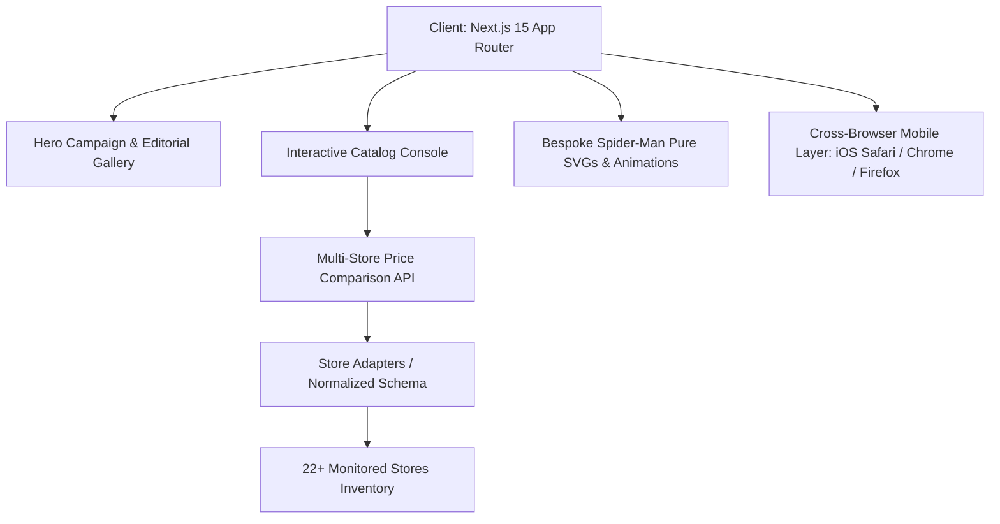

<div align="center">

# 🕷️ FOOTBALL TRACKING KIT
### *THE DARK SYMBIOTE COLLECTION · 22+ MONITORED BOUTIQUES*

[](https://nextjs.org/)
[](https://react.dev/)
[](https://www.typescriptlang.org/)
[](https://tailwindcss.com/)
[](#)
[](#)

<p align="center">
  <b>A luxury editorial football jersey discovery index and multi-store price comparison engine.</b><br>
  Curating player editions, fan cuts, and rare archival retros across 22+ independent boutiques in India with a permanent Dark Spider-Man aesthetic.
</p>

[**🌐 Live Demo**](https://kitscouts.vercel.app/) · [**📦 Repository**](https://github.com/ReubenGeoffrey/JerseyTrack) · [**⚡ Report Issue**](https://github.com/ReubenGeoffrey/JerseyTrack/issues)

---

</div>

<p align="center">
  
</p>

---

## 🕸️ The Aesthetic Vision

Inspired by the covert minimalism of **Zara High Fashion** blended with the stealth adrenaline of **Miles Morales & the Symbiote Black Suit**.

```
  ┌────────────────────────────────────────────────────────────────────────┐
  │  THE FOOTBALL COLLECTION.                                              │
  │  Pitch Black #07080c · Carbon Armor #0f1118 · Spider-Crimson #ff1744   │
  └────────────────────────────────────────────────────────────────────────┘
```

* **No Generic Dashboards**: Replaced chunky sports-store UI with oversized serif typography, editorial whitespace, and cinematic photography.
* **Pure Spider-Man SVGs**: Bespoke, scalable vector geometry (`SpiderInsigniaIcon`, `SpiderMaskIcon`, `SpiderWebGraphic`) embedded across cards, modals, and headers.
* **Atmospheric Micro-Interactions**: Ambient glowing red web pulses (`@keyframes spiderPulse`), floating levitation (`@keyframes spiderFloat`), and metallic sheen hovers.
* **Cross-Browser Mobile Perfection**: Optimized down to 44px minimum tap targets, momentum scrolling, and notch safe-area padding for Chrome Mobile, iOS Safari, and Firefox.

---

## 📸 Editorial Gallery

<table align="center" width="100%">
  <tr>
    <td width="50%" align="center">
      
      <br>
      <sub><b>01 · HISTORIC VAULT & RETRO CLASSICS</b><br>Archival shirts from 1990 to 2014</sub>
    </td>
    <td width="50%" align="center">
      
      <br>
      <sub><b>02 · AUTHENTIC PLAYER ISSUE</b><br>Heat-pressed club badges & athletic slim silhouettes</sub>
    </td>
  </tr>
  <tr>
    <td width="50%" align="center">
      
      <br>
      <sub><b>03 · 22+ MONITORED STORES</b><br>Live inventory feeds & price comparisons</sub>
    </td>
    <td width="50%" align="center">
      
      <br>
      <sub><b>04 · VERIFIED CLEARANCE MARKDOWNS</b><br>Instant notification of genuine store price cuts</sub>
    </td>
  </tr>
</table>

---

## ⚡ Core Capabilities

### 🔍 1. Real-Time Price Comparison Engine
When viewing any jersey, the platform matches equivalent kits across every monitored store in India.
* **Instant savings discovery**: Shows the lowest price, price differences (`+₹200`), sizes in stock, and direct checkout links.
* **Zero fabricated data**: Synchronized against real inventory from verified independent retailers.

### 🎽 2. Granular Discovery Console
* **Version Isolation**: Filter between *Player Issue*, *Fan Version*, and *Archive Retro*.
* **Boutique Selectors**: Multi-select store filters spanning 22+ boutiques with horizontal thumb-scroll for mobile.
* **Size Matrix**: Real-time availability for `S`, `M`, `L`, `XL`, `XXL`, and `3XL`.
* **Stock & Category Switches**: Quick toggles for in-stock shirts and jersey-only garments.

### 📱 3. Cross-Browser Mobile Ergonomics
* **Zero Tap Lag**: Configured `touch-action: manipulation` across all interactive elements.
* **Safe-Area Insets**: Adapts to iOS Safari home indicator bars with `env(safe-area-inset-bottom)`.
* **Momentum Sheet Scrolling**: `-webkit-overflow-scrolling: touch` with `overscroll-behavior: contain`.
* **Cross-Browser Scrollbars**: Styled Firefox (`scrollbar-color: #ff1744 #07080c`) and WebKit glass scrollbars.

---

## 🏬 Monitored Boutique Network (22+ Stores)

| Store | Specialization | Inventory Status | Direct Link |
| :--- | :--- | :---: | :---: |
| **Goal Thread** | Modern Player Issues & Retro Drops | `ACTIVE` | [Visit](https://goalthread.com) |
| **The Third Store** | Concept Kits & Club Player Issues | `ACTIVE` | [Visit](https://thethirdstore.com) |
| **Thayyil Sports** | High-Quality Fan Cuts & Retros | `ACTIVE` | [Visit](https://thayyilsports.com) |
| **MS Retro** | 90s & 2000s Archival Vintage Kits | `ACTIVE` | [Visit](https://msretro.in) |
| **Full Time Store** | Matchday Editions & Restocks | `ACTIVE` | [Visit](https://fulltimestore.in) |
| **Shopezzy** | Wide Selection Fan & Player Issues | `ACTIVE` | [Visit](https://shopezzy.com) |
| **Sansiro Sports** | Italian & European Classics | `ACTIVE` | [Visit](https://sansirosports.com) |
| **Football Monk** | Fan Wear & Archival Specials | `ACTIVE` | [Visit](https://footballmonk.in) |
| **Store 1914** | Archival Heritage & Legends | `ACTIVE` | [Visit](https://store1914.com) |
| **The Football Frenzy** | Matchwear & Limited Drops | `ACTIVE` | [Visit](https://thefootballfrenzy.com) |
| **Gully Sports** | Affordable Fan Cuts | `ACTIVE` | [Visit](https://gullysports.in) |
| **KitKrew** | Retro Reprints & Modern Releases | `ACTIVE` | [Visit](https://kitkrew.in) |
| *+ 10 More Boutiques* | *Verified Independent Stockists* | `ACTIVE` | [Explore All](/stores) |

---

## 🛠️ Architecture & Tech Stack



* **Frontend Framework**: [Next.js 15.1](https://nextjs.org/) (App Router, React 19)
* **Styling & Design System**: [Tailwind CSS 3.4](https://tailwindcss.com/) with permanent Dark Spider-Man theme tokens
* **Icons**: [Lucide React](https://lucide.dev/) + Handcrafted pure vector SVGs ([SpiderIcons.tsx](src/components/SpiderIcons.tsx))
* **State Management**: React Context (`FavoritesContext`, `ThemeContext`) with `localStorage` persistence
* **Font Typography**: `Bodoni Moda` (high-fashion display serif) + `Inter` (high-legibility body)

---

## 🚀 Getting Started

### Prerequisites
* Node.js 18.18+ or 20+
* npm, yarn, or pnpm

### Installation

1. **Clone the repository**:
   ```bash
   git clone https://github.com/ReubenGeoffrey/JerseyTrack.git
   cd JerseyTrack
   ```

2. **Install dependencies**:
   ```bash
   npm install
   ```

3. **Run the development server**:
   ```bash
   npm run dev
   ```
   Open [http://localhost:3000](http://localhost:3000) to view the application.

4. **Build for production**:
   ```bash
   npm run build
   npm run start -- -p 3000
   ```

---

## 🕷️ Color Palette

```
  ■ Primary Crimson    #ff1744    rgba(255, 23, 68, 1)
  ■ Symbiote Pitch     #07080c    rgba(7, 8, 12, 1)
  ■ Carbon Card        #0f1118    rgba(15, 17, 24, 1)
  ■ Web Border         #222638    rgba(34, 38, 56, 1)
  ■ High-Contrast Text #f4f5f9    rgba(244, 245, 249, 1)
  ■ Electric Blue      #00e5ff    rgba(0, 229, 255, 1)
```

---

<div align="center">

### Built for Football Purists · Powered by the Web

© 2026 **Football Tracking Kit**. All rights reserved.<br>
*Spider-Man is a trademark of Marvel Characters, Inc. Theme created for editorial design appreciation.*

[Back to top 🕷️](#-football-tracking-kit)

</div>
